# Replicating the Excelsior Scholarship's Enrollment Effects

*A partial replication of Joseph E. Howard's (2026) dissertation, **Excelsior Scholarship and College Enrollment in New York: Evidence of Unexpected Gains**.*

## Project Overview

New York introduced the Excelsior Scholarship in 2017 to help eligible residents cover tuition at public colleges and universities. In his dissertation, Howard (2026) examines whether enrollment changed following the program's introduction, using Pennsylvania as a comparison state. Through his analysis Howard found that enrollment in New York went up for Pell grant eligible students following the excelsior scholarship program's introduction. 

For this project, I recreate Howard's main findings for public institutions using the Integrated Postsecondary Education Data System (IPEDS) and Bureau of Labor Statistics (BLS) data from 2012 through 2019. Just like the original study did, I analyzed data  on first-time, full-time undergraduate enrollment and enrollment among Pell Grant recipients across Pennsylvania and New York public institutions. 

My main data limitations compared to Howard's original study was that I could not obtain Penn State's disaggregated campus-level. This meant that the instiution count for the control state, Pennsylvania, was lower than the count in Howard's study. Still, I was able to replicate Howard's methods, and nearly match his outcomes. 

## Data

I pulled the data and completed the cleaning process in my data cleaning notebook, found in the folder labeled "Data Cleaning" . I organized the raw files into three groups:

1. **IPEDS data:** Enrollment, Pell Grant recipients, tuition and fees, and institutional characteristics from the Integrated Postsecondary Education Data System.
2. **Bureau of Labor Statistics (BLS) data:** County-level unemployment rates.
3. **County FIPS data:** A county-name and FIPS-code file shared by an OpenDataPhilly user. I used this to connect the county names in my IPEDS files to the FIPS codes needed for the BLS merge. The IPEDS extracts I downloaded provided county names without the codes I needed.

| Source | Data I used | Years |
| --- | --- | --- |
| [IPEDS, National Center for Education Statistics](https://nces.ed.gov/ipeds/use-the-data) | Institution identifiers, enrollment counts, Pell Grant counts, tuition and fees, institutional control, and location | Fall 2012–2019 |
| [BLS, Local Area Unemployment Statistics](https://www.bls.gov/lau/) | County unemployment rates | 2011–2018, lagged one year |
| OpenDataPhilly user-contributed county FIPS file | County names and FIPS codes used to match IPEDS and BLS | County crosswalk |

For the analysis, my unit of observation is an **institution-year**. Where New York public institutions and Pennsylvania public institutions as the treatment and control groups, respectively. The treatment is the introduction of the Excelsior scholarship in 2017.

My final sample has **111 public institutions**, including **74 in New York and 37 in Pennsylvania**, observed over eight years (Different than Howard because he had 125 institutions total, and 51 in Pennsylvania).

### Main Variables

| Variable | Definition |
| --- | --- |
| `unitid` | Identify institutions, add institution fixed effects, and cluster standard errors |
| `fall_year` | Identify the year and add year fixed effects |
| `state` | Distinguish New York from Pennsylvania |
| `Grand total` | First-time, full-time undergraduate student enrollment count|
| `Number of full-time first-time undergraduates awarded Pell grants` | First-time, full-time Pell Grant awarded students  count |
| `Published in-state tuition and fees` | Represents the logged tuition variable for adjusted models |
| `unemp_lag` | Control for county unemployment in the preceding year |

These are the main variables I use in the analysis notebook.

## Data Cleaning

My cleaning process is in full detail in the Data cleaning Python notebook tittled "Data_cleaning.ipynb. Where I started with separate annual IPEDS files and BLS data and merged them into one institution-year panel.

1. **Merging IPEDS files.** I merged the annual Pell Grant, race and gender enrollment, and tuition files using `unitid`. I also standardized the column names across years.
2. **Creating the panel.** I combined the annual datasets into one file and added `fall_year`.
3. **Adding county FIPS codes.** I matched the IPEDS county names to the county FIPS crosswalk sourced from an OpenDataPhilly user.
4. **Merging unemployment data.** I cleaned the BLS files and matched unemployment rates to institutions using county FIPS codes. I lagged unemployment by one year (`unemp_year = fall_year - 1`).
5. **Keeping public institutions.** I used the IPEDS institutional-control variable to identify public colleges and universities.
6. **Applying exclusions.** I excluded specialty institutions identified in Howard's dissertation and removed Penn State campuses because of the 2019 data limitation.
7. **Saving the cleaned dataset.** I exported the final panel as `panel_clean.csv` for the analysis notebook.

### Why I Excluded Penn State

Beginning in 2019, Penn State changed how it reported campus enrollment data in IPEDS, reporting all data from separate campuses under separate campus names before 2018, and then began merging them into one "Penn State" name in 2019. Howard obtained supplemental campus-level data directly from Penn State to keep 2019 analysis consistent with the other years, but I did not have access to those records. So I chose to remove all Penn State campuses so I could keep a consistent set of institutions across years without filling in missing values.

This is the exclusion I use for my final sample:

```python
psu = panel["institution name"].str.startswith(
    "Pennsylvania State University",
    na=False
)

panel = panel.loc[~psu].copy()
```

The exclusion changes the Pennsylvania comparison group, so my results will not match Howard's estimates exactly.

## Analysis

My analysis can be found in [`Excelsior_Replication_Step_by_Step.ipynb`](Excelsior_Replication_Step_by_Step.ipynb). In that Python notebook, I  perform Howards' DiD and Event study as well as replicated some of his other figures, and compare my results to his tables 10-13. 


### 1. Checking Parallel Trends

I first plotted average enrollment in New York and Pennsylvania between 2012 and 2019. 

**First-Time, Full-Time Undergraduate Enrollment**

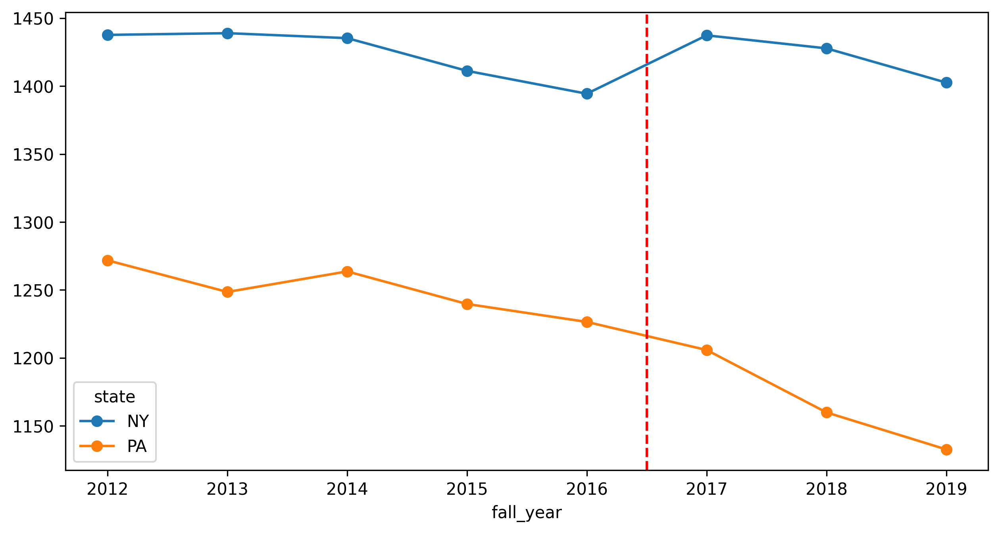

**Pell Grant Recipient Enrollment**

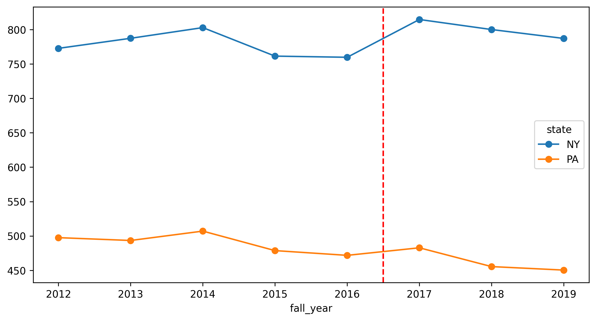


I then tested whether the two states had significantly different linear enrollment trends before treatment. For the statistical test, I interact the New York indicator with a linear time trend and include institution and year fixed effects. I run the test with treatment beginning in both 2017 and 2018.

<td valign="top">
  <a href="Figures/Parallel_Trends_Stats.png">
    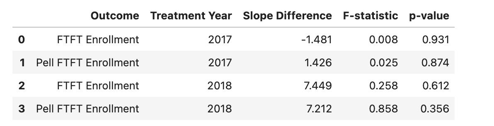
  </a>
</td>

None of my pretreatment slope tests were statistically significant at the 5% level. I therefore fail to reject the null hypothesis that the pretreatment slopes are equal, which provides some support for the parallel trends assumption.


### 2. Difference-in-Differences

Next, I estimate two-way fixed-effects DiD models:

$$
Y_{it} = \alpha + \gamma_i + \lambda_t + \beta(\text{NY}_i \times \text{Post}_t) + \varepsilon_{it}
$$

Here, $Y_{it}$ is enrollment at institution $i$ in year $t$, while $\gamma_i$ and $\lambda_t$ represent institution and year fixed effects. The coefficient $\beta$ captures the estimated change in New York enrollment relative to Pennsylvania after treatment.

Following Howard's approach, I run separate models with treatment starting in **2017** and **2018**. He analyzed both years because he wasn't sure if the 2017 cohort would've been impacted by the scholarship so soon after its announcement.


### 3. Event Study

Lastly, I estimate enrollment differences separately for each year, using **2016 as the reference year** because it was the last year before the Excelsior Scholarship was introduced in 2017 allowing  me to examine how enrollment differences between New York and Pennsylvania changed before and after the program's introduction.

```math
Y_{it} = \alpha + \gamma_i + \lambda_t + \sum_{k \ne 2016} \delta_k (\text{NY}_i \times \mathbf{1}[t=k]) + \varepsilon_{it}
```

I use the estimates from 2012–2015 to examine pretreatment differences and the estimates from 2017–2019 to examine changes following Excelsior's introduction. I also plot the coefficients with 95% confidence intervals.

The event-study models reported below include institution and year fixed effects and institution-clustered standard errors (they don't include the additional tuition and unemployment covariates.)

## Main Findings

### Difference-in-Differences Results

After adding tuition and lagged county unemployment, my estimated treatment coefficients decreased across all four models. The coefficients remained positive, although none were statistically significant at the 5% level.

Overall, I find a similar pattern to Howard's DiD results. Where the estimates suggest increases in enrollment, however the models still have substantial uncertainty demonstrated by.. [need to be more specific here].

#### DiD Tables: My Findings and Howard's Tables 10 and 11

**Treatment begins in 2017**

<table>
<tr><th width="50%">My 2017 DiD results</th><th width="50%">Howard's Table 10</th></tr>
<tr>
<td valign="top">
<table>
<tr><th>Outcome</th><th>Without covariates</th><th>With covariates</th></tr>
<tr><td>FTFT enrollment</td><td align="right">82.99</td><td align="right">38.26</td></tr>
<tr><td>Pell FTFT enrollment</td><td align="right">50.64</td><td align="right">27.14</td></tr>
</table>
<p>I find positive estimates for both outcomes, but neither adjusted estimate is significant at the 5% level.</p>
</td>
<td valign="top"><a href="Figures/howard_table10.png">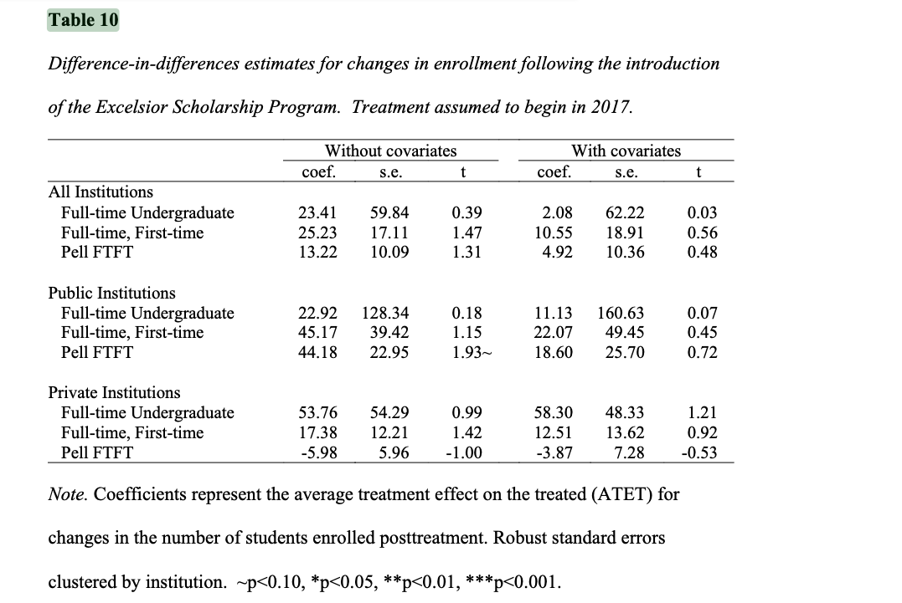</a></td>
</tr>
</table>

**Treatment begins in 2018**

<table>
<tr><th width="50%">My 2018 DiD results</th><th width="50%">Howard's Table 11</th></tr>
<tr>
<td valign="top">
<table>
<tr><th>Outcome</th><th>Without covariates</th><th>With covariates</th></tr>
<tr><td>FTFT enrollment</td><td align="right">85.78</td><td align="right">58.33</td></tr>
<tr><td>Pell FTFT enrollment</td><td align="right">46.11</td><td align="right">30.30</td></tr>
</table>
<p>The estimates remain positive when I move treatment to 2018, but neither adjusted coefficient is significant at the 5% level.</p>
</td>
<td valign="top"><a href="Figures/howard_table11.png">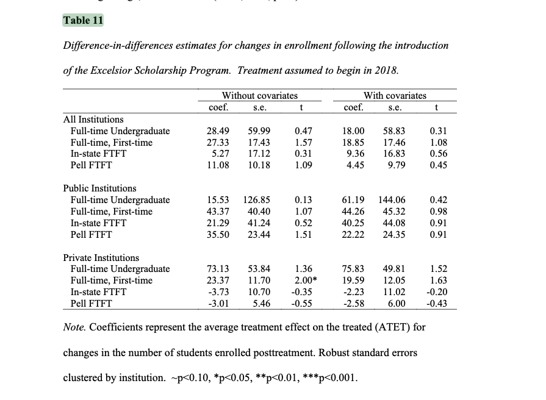</a></td>
</tr>
</table>


### Event-Study Results

My event-study estimates show positive enrollment changes in New York following Excelsior's introduction.

For first-time, full-time undergraduate enrollment, all three post-treatment coefficients were statistically significant at the 5% level. The estimates suggest increases of approximately 64, 100, and 102 students per New York public institution in 2017, 2018, and 2019, respectively, relative to Pennsylvania.

I observed similar results for Pell Grant recipients. The estimated increases were approximately 44 students in 2017, 57 in 2018, and 49 in 2019. The 2017 and 2018 coefficients were significant at the 5% level, while the 2019 estimate was marginally significant at the 10% level.

None of the individual pretreatment event-study coefficients were statistically significant at the 5% level. I still need to report the joint pretreatment test alongside these estimates.

My results are generally consistent with Howard's main event-study findings. The differences in coefficient magnitudes may be related to my exclusion of Penn State and other differences in how the data were constructed.

#### Event-Study Tables: My Findings and Howard's Tables 12 and 13

**First-time, full-time enrollment**

<table>
<tr><th width="50%">My FTFT event-study results</th><th width="50%">Howard's Table 12</th></tr>
<tr>
<td valign="top">
<table>
<tr><th>Year</th><th>Estimate</th><th>p-value</th></tr>
<tr><td>2017</td><td align="right">63.65</td><td align="right">0.004</td></tr>
<tr><td>2018</td><td align="right">100.01</td><td align="right">0.002</td></tr>
<tr><td>2019</td><td align="right">102.05</td><td align="right">0.017</td></tr>
</table>
<p>My post-treatment estimates are positive and significant at the 5% level in all three years, similar to Howard's findings.</p>
</td>
<td valign="top"><a href="Figures/howard_table12.png">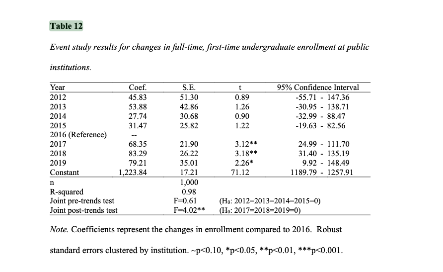</a></td>
</tr>
</table>

**Pell Grant enrollment**

<table>
<tr><th width="50%">My Pell FTFT event-study results</th><th width="50%">Howard's Table 13</th></tr>
<tr>
<td valign="top">
<table>
<tr><th>Year</th><th>Estimate</th><th>p-value</th></tr>
<tr><td>2017</td><td align="right">43.97</td><td align="right">0.001</td></tr>
<tr><td>2018</td><td align="right">56.69</td><td align="right">0.005</td></tr>
<tr><td>2019</td><td align="right">48.84</td><td align="right">0.058</td></tr>
</table>
<p>I find statistically significant increases in 2017 and 2018. The 2019 estimate is marginally significant at the 10% level.</p>
</td>
<td valign="top"><a href="Figures/howard_table13.png">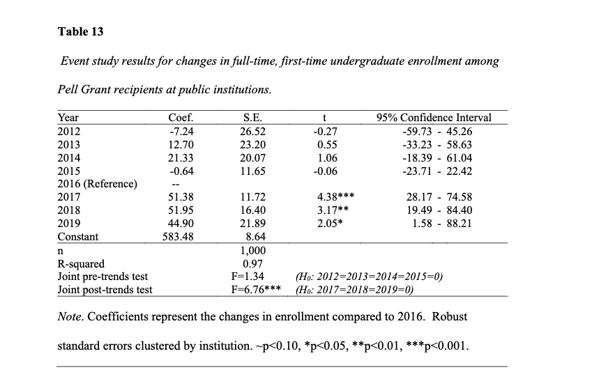</a></td>
</tr>
</table>

#### Event-Study Figures: My Estimates and Howard's Figures

**First-time, full-time enrollment**

<table>
<tr><th width="50%">My FTFT event-study figure</th><th width="50%">Howard's FTFT event-study figure</th></tr>
<tr>
<td valign="top"><a href="Figures/event_study_ftft.png">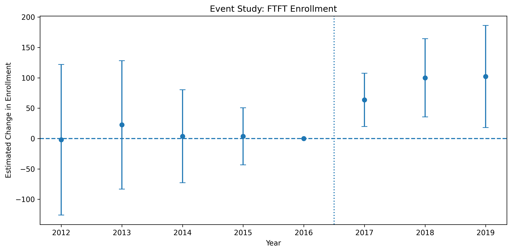</a></td>
<td valign="top"><a href="Figures/howard_event_study_ftft.png">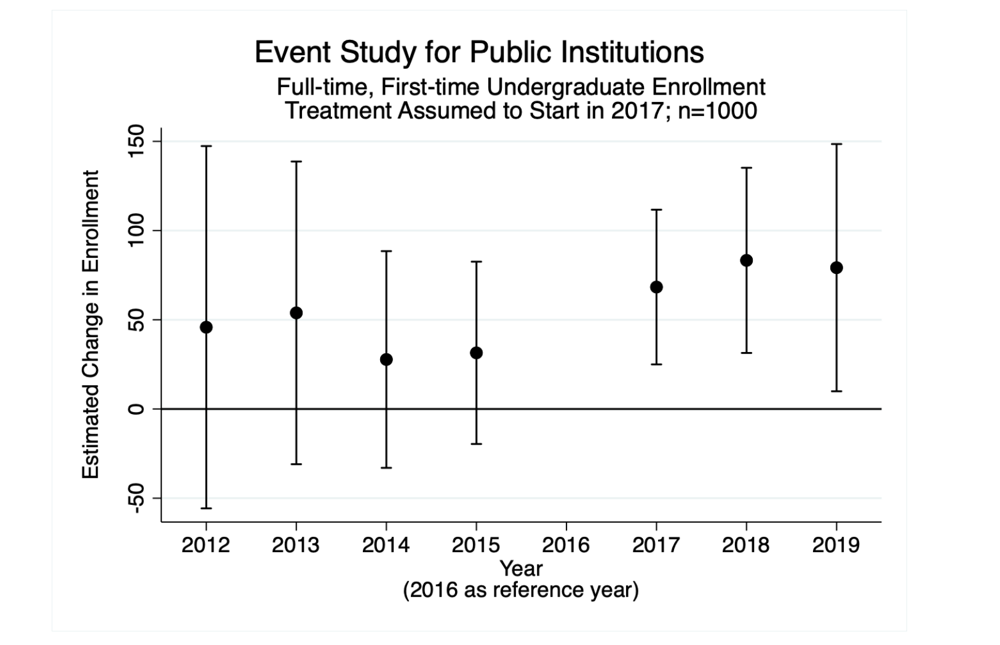</a></td>
</tr>
</table>

**Pell Grant enrollment**

<table>
<tr><th width="50%">My Pell FTFT event-study figure</th><th width="50%">Howard's Pell FTFT event-study figure</th></tr>
<tr>
<td valign="top"><a href="Figures/event_study_pell.png">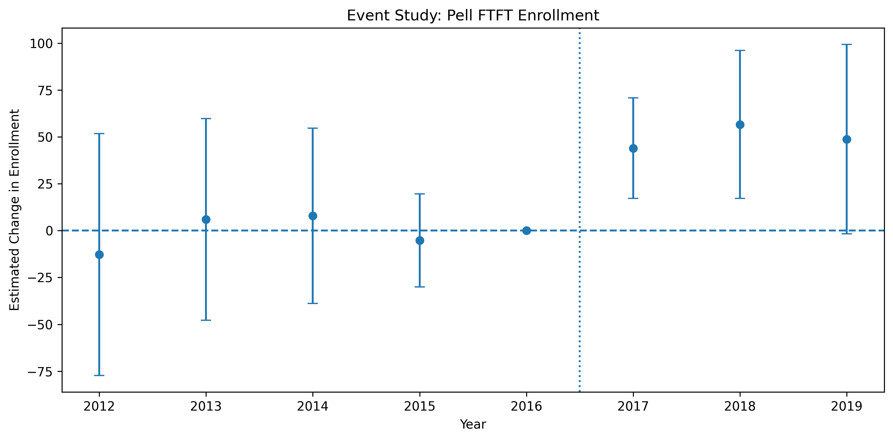</a></td>
<td valign="top"><a href="Figures/howard_event_study_pell.png">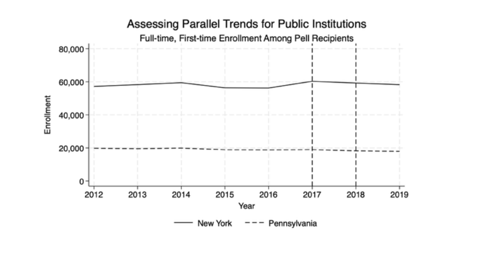</a></td>
</tr>
</table>

#### Reading the Figures

I compare my figures with Howard's figures for the same outcomes and treatment dates. I also keep the regression tables together above so I can compare the coefficients directly. Differences in our institutional samples are important when interpreting any differences in the estimates.


## Extension: Race × Gender Effects (Effect Coding)

To examine who Excelsior's enrollment gains reached, I re-estimated the DiD on log FTFT enrollment, ln(1 + N), for each of 14 race × gender groups. Following Mayhew and Simonoff (2015) and López et al. (2018), I used effect coding, which compares each group with the unweighted average of all groups. Each group gets its own institution and year fixed effects, and standard errors are clustered by institution. Pre-trend tests passed for every racial group after a Holm correction, and for the gender gap (χ²(4) = 6.00, p = 0.20).

<table>
<tr><th width="50%">Pre-trends by racial group</th><th width="50%">Pre-trends for the gender gap</th></tr>
<tr>
<td valign="top"></td>
<td valign="top"></td>
</tr>
</table>

| Racial group | Pre-trend χ²(4) | p | p (Holm) |
|---|---:|---:|---:|
| AIAN | 9.941 | 0.041 | 0.290 |
| Asian | 3.801 | 0.434 | 1.000 |
| Black | 6.567 | 0.161 | 0.642 |
| Hispanic | 3.112 | 0.539 | 1.000 |
| Multiracial | 8.243 | 0.083 | 0.493 |
| NHPI | 2.249 | 0.690 | 1.000 |
| White | 8.271 | 0.082 | 0.493 |

Black and multiracial students gained the most relative to the average. At the race level, Black students were about 0.15 log points above the average group (Holm-adjusted p = 0.004 for 2017, 0.016 for 2018) and multiracial students about 0.30 above it (Holm-adjusted p = 0.016 for 2018). Across all racial groups, men's enrollment rose about 0.095 log points more than women's (95% CI 0.04 to 0.15, p < 0.001). When I break the results out into all 14 race × gender groups and correct for testing all of them, Black men (both years) and multiracial men (2018) remain significantly above the average. Black and multiracial women also had positive estimates above the average, but these were not significant after the correction.

**Each group's Excelsior effect minus the average of all 14 groups (log points; 0.10 ≈ 10%; \* Holm-adjusted p < 0.05 across 14 groups)**

| Group | Men, 2017 | Women, 2017 | Men, 2018 | Women, 2018 |
|---|---:|---:|---:|---:|
| Black | 0.173* | 0.120 | 0.183* | 0.123 |
| Multiracial | 0.275 | 0.206 | 0.331* | 0.267 |
| White | 0.015 | −0.062 | 0.010 | −0.072 |
| Asian | 0.041 | −0.132 | −0.022 | −0.183 |
| Hispanic | −0.074 | −0.130 | −0.104 | −0.173 |
| AIAN | 0.082 | −0.151 | 0.106 | −0.106 |
| NHPI | −0.179 | −0.184 | −0.171 | −0.189 |

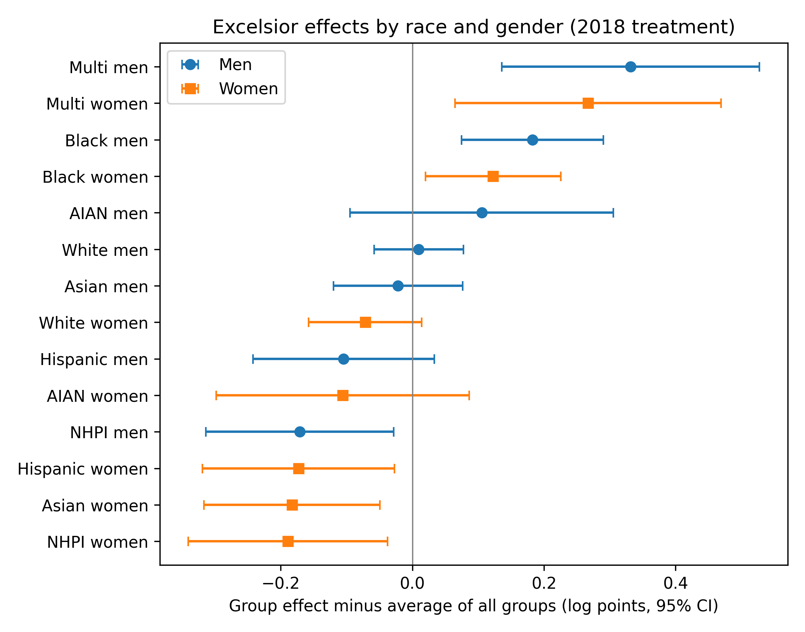

Because the effects are measured against the average, they sum to zero, so groups below zero gained less than the average group, though their own enrollment did not necessarily decline. AIAN and NHPI estimates are imprecise, since these groups average only about 5 and 2 FTFT students per institution. The Black estimate stayed positive but shrank and lost significance in a Poisson model on raw counts, which suggests the gain was larger at smaller institutions. The multiracial estimate held up across all robustness checks.

### Interaction Effects and Contributions to QuantCrit

| Test | 2017 | 2018 |
|---|---:|---:|
| Men − women gap (log points) | 0.095 (95% CI 0.044 to 0.146), p < 0.001 | 0.095 (95% CI 0.038 to 0.152), p = 0.001 |
| Race × gender interaction terms, χ²(6) | 6.16, p = 0.406 | 3.22, p = 0.781 |

The race × gender interaction terms let me look at the specific social locations students occupy at the intersection of race and gender. López et al. (2018) describe these intersections as distinct categories of experience, shaped at the same time by race, gender, and class. By estimating an effect for each of the 14 race × gender groups, I can compare students within the same racial group, such as Black men and Black women (what López et al., drawing on McCall, call intracategorical intersectionality), and across racial groups (intercategorical intersectionality). The joint test found no evidence that the gender gap differed by race. Meaning, men gained about 10% more than women in every racial group, and Black and multiracial students of both genders had estimates above the average, with Black men and multiracial men showing the clearest gains. I could only see these patterns because I made the conscious decision to disaggregate the data, which follows López et al.'s call for making the invisible visible.

Effect coding was a second deliberate data decision. By comparing every group with the average of all groups, the model decenters whiteness, and White students become one social location among fourteen. Overall, disaggregating the data and decentering whiteness are my two main contributions to QuantCrit in this project. At its core, QuantCrit is about the data decisions we make, including which groups we count, which group we compare against, and how we interpret the gaps we find, along with how we interrogate systems of power once those discrepancies are uncovered. Following López et al. (2018), I read the larger gains for Black and multiracial students, and the smaller estimated gains for Hispanic, Asian, and NHPI students, as signals of how structural racism and the broader matrix of domination shape who a policy like Excelsior reaches. Now that these patterns are identified, I am better equipped to dig into the specific systems at play, such as the income eligibility cap, the full-time and 30-credit requirements, the institutions where different groups enroll, and how information about the program reached different communities.

## Limitations

My analysis has several limitations that are important for interpreting the findings.

- **Penn State:** I excluded all Penn State campuses because I did not have the disaggregated 2019 data Howard used. This changes the Pennsylvania sample and limits how closely I can reproduce his estimates.
- **Student migration:** I did not recreate Howard's in-state enrollment models because I did not have the migration data needed for those specifications.
- **Causal interpretation:** My analysis depends on the parallel trends assumption and the absence of other shocks that affected the two states differently. The pretreatment tests provide some support, but they cannot establish those assumptions.
- **Scope:** I focused on the main public-institution findings. I did not recreate every outcome, institutional sector, or additional analysis in the dissertation.

## Reference

Howard, J. E. (2026). *Excelsior scholarship and college enrollment in New York: Evidence of unexpected gains* [Doctoral dissertation, University of Pennsylvania].


